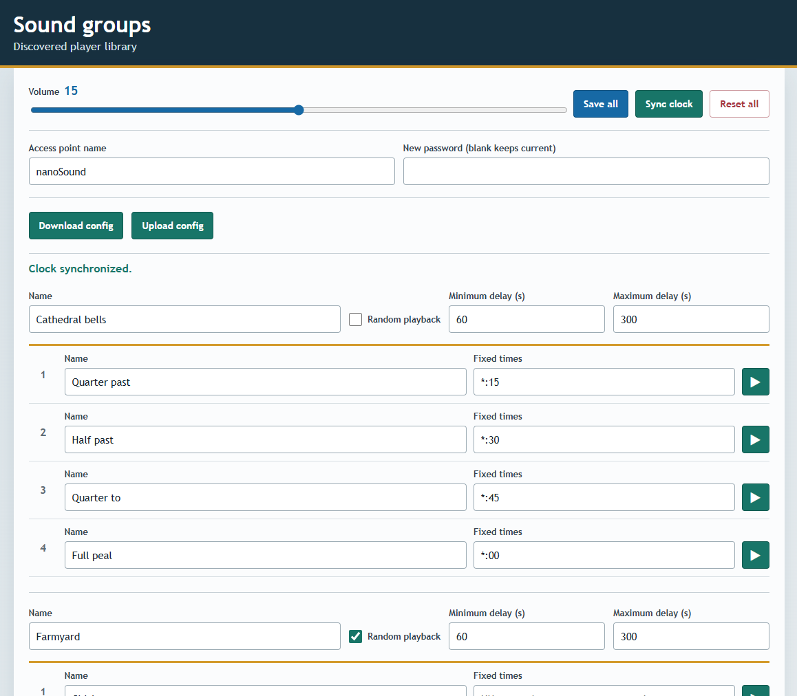
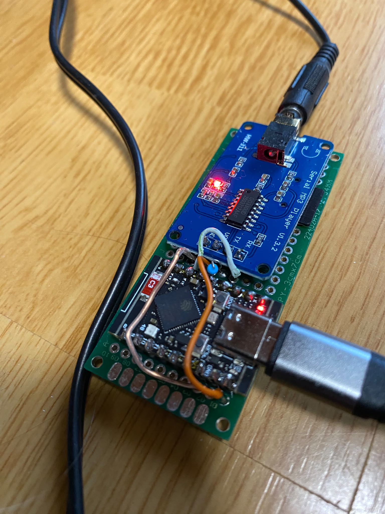

# nanoSound

A generic .NET nanoFramework ESP32-S3 Mini sound scheduler for the
**Serial MP3 Player v1.3.2**. It discovers numbered folders and tracks from the
player, then exposes their names, schedules, and random-playback settings in a
mobile web interface.

See the illustrated [French software guide](docs/GUIDE_UTILISATION_FR.md) for
the web interface, configuration transfer, persistence, and diagnostics.



## Required hardware

- ESP32-S3 Mini running a .NET nanoFramework image with UART support
- YX5200/YX5300-compatible serial MP3 player
- FAT16/FAT32 microSD card
- Speaker compatible with the player module's amplified output
- 1 kOhm series resistor for the player's RX connection
- USB data cable and a stable 5 V supply suitable for the player and speaker



## Player compatibility

The project uses the official
[`nanoFramework.Iot.Device.Yx5300`](https://www.nuget.org/packages/nanoFramework.Iot.Device.Yx5300)
binding. It is compatible when the player uses the YX5200/YX5300 protocol:
9600 baud, `7E FF 06 ... EF` packets, TF/microSD storage, and the `0x0F`
folder/file command. This is the protocol normally sold as Serial MP3 Player
v1.3.2 and DFR0299.

The binding sends checksummed 10-byte packets and waits for module feedback.
That is preferable to maintaining a second UART implementation here.

## Wiring

| ESP32-S3 Mini | MP3 player |
| --- | --- |
| 5V/VIN | VCC |
| GND | GND |
| GPIO 4 (COM2 TX) | RX, through 1 kOhm |
| GPIO 5 (COM2 RX) | TX |

TX and RX are crossed intentionally. The ESP32 and player must share ground.
Do not power the player from the ESP32's 3.3 V pin. On the ESP32-S3, keep GPIO
19/20 reserved for native USB and GPIO 43/44 reserved for UART0 deployment.
Connect the speaker to the player's speaker terminals, never to an ESP32 GPIO.

## SD card

The prepared card layout is:

```text
01/
  001.mp3  quarter past
  002.mp3  half past
  003.mp3  quarter to
  004.mp3  full Westminster sequence and cathedral peal
02/
  001.mp3  chickens
  002.mp3  cows
  003.mp3  ducks
  004.mp3  goats
  005.mp3  sheep
  006.mp3  pigs
  007.mp3  rooster
  008.mp3  horse
03/
  001.mp3  sword clash
  002.mp3  French market
  003.mp3  galloping horses
  004.mp3  horse-drawn carriage
  005.mp3  blacksmith
```

At startup, the firmware asks the MP3 module for its folder count, total track
count, and track count in each folder. Some compatible clones ignore the folder
parameter and report the last-played folder instead, so discovery briefly mutes
the player and selects the first track in each folder before querying its count.
Discovery results are accepted only when the per-folder counts add up to the
reported total.

The farm and medieval-city tracks use real recordings from freely reusable
sources. Farm tracks retain their original length; city tracks are capped at 30
seconds. Each track plays once without looping. Their creators, source pages,
licenses, and audio modifications are listed in
[SOUND_ATTRIBUTION.md](SOUND_ATTRIBUTION.md).
The firmware does not assign meaning to folder or track numbers. New folders
are named `Group N`, new tracks are named `Sound N`, schedules are empty, and
random playback is disabled until configured. The included prepared sound card
can be labeled and scheduled by uploading
[`config/prepared-sound-library.txt`](config/prepared-sound-library.txt).

## Wi-Fi and web controls

The ESP32 runs as a WPA2 access point and does not connect to another Wi-Fi
network:

| Setting | Value |
| --- | --- |
| Network | `nanoSound` |
| Password | `LaurentIsTheBest` |
| Control page | `http://nanoSound.local/` or `http://192.168.4.1/` |

Connect a phone or computer to `nanoSound`, then open the control page. It can
play any discovered track, configure random playback independently per folder,
set delays from 0 to 86400 seconds, assign fixed schedules, rename folders and
tracks, and adjust volume from 0 to 30.

Use **Download config** to back up all UI settings, including the access-point
credentials. Use **Upload config** to validate and restore a backup. Imported
folder and track settings are reconciled with the library currently reported by
the MP3 player, so nonexistent entries are discarded and newly discovered ones
receive generic names.

All UI changes and successful imports are saved in `I:\sound-config.txt` in
ESP32 internal storage. Saving uses `I:\sound-config.tmp` before replacing the
active file.
The web assets are stored separately as `I:\Web\index.html`,
`I:\Web\app.js`, and `I:\Web\config.js`; no default configuration file
is deployed with firmware.

The `.local` address requires mDNS/Bonjour support on the phone or computer.
Use `http://192.168.4.1/` if the hostname is not resolved.

When startup detects different access-point settings, the firmware saves them
and automatically restarts using a one-second deep sleep. It then starts DHCP
and the web server if the settings match. To apply network changes saved from
the web interface, restart the device once to begin this process. If the wake-up
timer fails or the settings still differ after the automatic restart, the device
stops retrying and reports the failure in the debug output.
The page sources are `nanoSound/Web/index.html`, `nanoSound/Web/app.js`, and
`nanoSound/Web/config.js`. Deploying the project uploads all three to ESP32
internal storage.

All files are 44.1 kHz mono, constant 128 kbit/s MP3. Format a microSD card as
FAT16 or FAT32, then copy the `01`, `02`, and `03` directories from `sd-card` to
the card root. Numeric names and copy order matter on some YX5300 modules, so
copy to an empty card in filename order.

When replacing existing sounds, do not overwrite the files in place. Delete the
affected folder from the physical card (or reformat the card), copy its prepared
folder from `sd-card` back to the card, safely eject it, and power-cycle the MP3
module. The module indexes FAT directory entries and can keep using the old
track order until its storage is rescanned after a full power cycle.

To regenerate the chimes and download and prepare the farm recordings, install
Python 3 and FFmpeg, ensure internet access to Wikimedia Commons, then run:

```powershell
python tools/generate_chimes.py
python tools/generate_farm_sounds.py
python tools/generate_medieval_city_sounds.py
```

## Build and deploy

Install the .NET nanoFramework extension and flash an ESP32-S3 nanoFramework image
with UART support. Restore from NuGet and build:

```powershell
nuget restore nanoSound\packages.config -PackagesDirectory packages -Source https://api.nuget.org/v3/index.json
msbuild nanoSound.sln /p:Platform="Any CPU" /p:Configuration=Release /verbosity:minimal
```

Select the ESP32 in nanoFramework Device Explorer and deploy the project. The
nanoFramework deploy provider uploads the managed assemblies and all three web
assets.

## Release and flashing

Download `nanoSound.zip` from the repository's GitHub Releases page and extract
it. A push of a `v*` tag builds and publishes the release; regular builds also
provide the `nanoSound` Actions artifact. The ZIP contains the managed
`nanoSound.bin`, the web files, and `Web/web-deploy.json`. It does not contain
the nanoFramework firmware.

### Install .NET and nanoff

Install the [.NET 8 runtime](https://dotnet.microsoft.com/download/dotnet/8.0)
to run nanoff `3.0.0-preview.1`. Installing it with `dotnet tool` also requires a
.NET SDK, such as the [.NET 10 SDK](https://dotnet.microsoft.com/download/dotnet/10.0),
which does not include the .NET 8 runtime. .NET 8 is out of support; update
nanoff when it supports a newer runtime.

```powershell
dotnet tool install --global nanoff --version 3.0.0-preview.1
nanoff --version
nanoff list devices
```

An already installed nanoff needs only its runtime. To update it, use
`dotnet tool update --global nanoff --version 3.0.0-preview.1` instead.
If the command is not found, reopen PowerShell and ensure
`$env:USERPROFILE\.dotnet\tools` is on `PATH`.

The examples below use `ESP32_S3_QUAD`. Replace `COM7` with the device's port
and close Device Explorer or other programs that hold it.

Run the following commands from the extracted artifact directory.

### Deploy without mass erase

With compatible nanoFramework firmware already installed, deploy the application:

```powershell
nanoff deploy target ESP32_S3_QUAD serialport COM7 image .\nanoSound.bin
```

This replaces the managed application without requesting a mass erase. Back up
your configuration using **Download config** before changing the device.

### Flash with mass erase

**Warning:** mass erase can remove the firmware, application, network settings,
and internal files, including `I:\sound-config.txt`. Back up first and verify
the target and firmware compatibility:

```powershell
nanoff flash target ESP32_S3_QUAD serialport COM7 masserase
nanoff deploy target ESP32_S3_QUAD serialport COM7 image .\nanoSound.bin
```

Both paths require the web assets below. Wait for the device to finish booting
and any automatic AP-configuration restart before deploying the files.

### Deploy the web files

From the extracted ZIP's root directory, upload the three files to `I:\Web`:

```powershell
nanoff deploy file .\Web\web-deploy.json serialport COM7
```

Check that nanoff reports success for **each** file, then open
`http://192.168.4.1/`. After a mass erase, re-import your saved configuration if
needed and synchronize the clock.

### Dependency updates

Dependabot checks GitHub Actions and is configured for NuGet. Its current NuGet
updater does not recognize `.nfproj` projects, so the scheduled **Update
nanoFramework dependencies** workflow also uses the official `nanodu` action
to update the solution's packages and project references. Enable GitHub Actions
permission to create pull requests in the repository settings. PRs created with
`GITHUB_TOKEN` may not trigger the build automatically; run it manually or use a
suitably scoped GitHub App or personal access token if automatic PR builds are
required. Review native firmware compatibility before merging package updates.

nanoFramework keeps system time in UTC. Use **Sync clock** in the web interface
to set the device clock and store the browser's current time-zone offset before
relying on schedules. Synchronize again after a daylight-saving transition or
when the device clock has been lost.

The default volume is `15` on the module's `0`-`30` scale and can be changed
from the web control panel.
