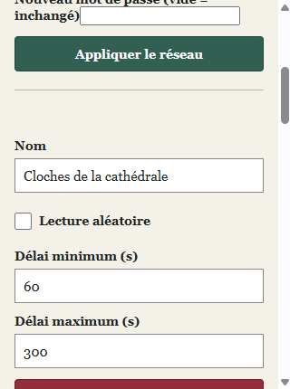

# Guide logiciel de nanoSound

Ce guide décrit uniquement le fonctionnement et l'utilisation du logiciel
nanoSound : démarrage, interface Web, configuration, stockage interne et
diagnostic.

## 1. Fonctionnement général

Au démarrage, nanoSound :

1. charge la configuration enregistrée dans la mémoire interne ;
2. interroge le lecteur audio pour connaître le nombre de dossiers et de pistes ;
3. rapproche la bibliothèque détectée de la configuration enregistrée ;
4. démarre le point d'accès Wi-Fi, le serveur Web et le service mDNS ;
5. exécute en continu les demandes manuelles, les horaires fixes et les lectures
   aléatoires.

Le logiciel est générique. Il n'attribue aucune signification particulière aux
numéros de dossiers ou de pistes. Lorsqu'aucune configuration correspondante
n'existe :

- un dossier reçoit le nom `Group N` ;
- une piste reçoit le nom `Sound N` ;
- la lecture aléatoire est désactivée ;
- aucun horaire fixe n'est défini ;
- les délais aléatoires sont initialisés à 60 et 300 secondes.

Les noms physiques des fichiers audio ne sont pas disponibles par le protocole
du lecteur. Tous les noms affichés viennent donc de la configuration nanoSound.

## 2. Connexion au logiciel

Les valeurs réseau initiales sont :

| Paramètre | Valeur |
| --- | --- |
| Réseau Wi-Fi | `nanoSound` |
| Mot de passe | `LaurentIsTheBest` |
| Adresse mDNS | `http://nanoSound.local/` |
| Adresse directe | `http://192.168.4.1/` |

Le point d'accès est autonome et ne nécessite ni routeur ni accès Internet.
L'adresse en `.local` requiert mDNS/Bonjour ; utiliser l'adresse directe si elle
n'est pas résolue.

Si la configuration native du point d'accès diffère des réglages enregistrés,
nanoSound la met à jour puis redémarre automatiquement après une seconde de
sommeil profond. Si le réveil ne peut pas être configuré ou si la configuration
diffère encore après le redémarrage, la sortie de débogage indique l'échec et
aucune nouvelle tentative automatique n'est effectuée.

## 3. Interface Web

L'interface adopte automatiquement le français lorsque la langue du navigateur
commence par `fr`. Elle charge son état depuis `/api/state` et désactive la mise
en cache des ressources afin d'afficher la version déployée.


### Réglages généraux

- **Volume** règle le lecteur de 0 à 30.
- **Tout enregistrer**, présent en haut et en bas de la page, valide puis
  enregistre en une seule opération le volume, le réseau, tous les groupes et
  toutes les pistes.
- **Synchroniser l'heure** copie l'heure UTC du navigateur dans l'appareil et
  enregistre son décalage de fuseau horaire.
- **Tout réinitialiser** conserve la bibliothèque détectée, mais restaure les
  noms génériques, le volume 15, le fuseau zéro, les délais 60/300, les horaires
  vides, la lecture aléatoire désactivée et les identifiants Wi-Fi initiaux.

Une modification des identifiants réseau nécessite un cycle d'alimentation.

### Réseau Wi-Fi

- **Nom du point d'accès** accepte de 1 à 32 octets UTF-8.
- **Nouveau mot de passe** accepte de 8 à 63 octets UTF-8.
- Un mot de passe laissé vide conserve la valeur actuelle.
- **Tout enregistrer** inclut les nouvelles valeurs réseau dans la configuration
  interne. Elles sont appliquées à la configuration Wi-Fi native au démarrage.

### Sauvegarde et restauration

- **Télécharger la configuration** récupère l'état complet sous le nom
  `nanoSound-config.txt`.
- **Importer la configuration** valide un fichier, l'adapte à la bibliothèque
  actuellement détectée, l'enregistre en mémoire interne, puis actualise la
  page.

Le fichier téléchargé contient :

- le volume et le fuseau horaire ;
- le nom et le mot de passe du point d'accès ;
- les noms, options et délais de tous les groupes ;
- les noms et horaires de toutes les pistes.

Les champs texte sont encodés en Base64 pour rester compatibles avec le format
ligne par ligne. Le Base64 n'est pas un chiffrement : conserver le fichier comme
un secret, car il contient le mot de passe Wi-Fi.

Le fichier est entièrement validé avant son application. Un fichier incomplet,
dupliqué, d'une version inconnue ou contenant une valeur invalide est refusé
sans remplacer la configuration active.

La configuration fournie dans
[`config/prepared-sound-library.txt`](../config/prepared-sound-library.txt)
recrée les noms, horaires et options de la bibliothèque audio préparée avec le
projet. Elle n'est pas déployée automatiquement et reste un exemple importable.



### Groupes de sons

Chaque dossier détecté devient un groupe numéroté.

- **Nom** définit le libellé affiché.
- **Lecture aléatoire** active la sélection automatique d'une piste de ce groupe.
- **Délai minimum / maximum** définit l'attente aléatoire en secondes, de 0 à
  86 400. Le maximum doit être supérieur ou égal au minimum.
- Les modifications sont incluses lors du prochain **Tout enregistrer**.

Chaque groupe aléatoire gère sa propre prochaine échéance. Lorsqu'il devient
éligible, une piste du groupe est choisie aléatoirement.

### Pistes

Chaque piste détectée possède :

- un **Nom** modifiable ;
- des **Heures fixes** facultatives ;
- un bouton **▶** pour demander une lecture immédiate ;
- les modifications de nom et d'horaires, incluses lors du prochain
  **Tout enregistrer**.

Formats d'horaire acceptés :

| Exemple | Signification |
| --- | --- |
| `08:30` | tous les jours à 08 h 30 |
| `*:15` | toutes les heures à la minute 15 |
| `10:00,16:00` | tous les jours à 10 h et 16 h |
| champ vide | aucune lecture planifiée |

Une piste planifiée n'est déclenchée qu'une fois pendant une minute donnée.
L'ordre de priorité logiciel est : demande manuelle, horaire fixe, puis lecture
aléatoire.

## 4. Rapprochement avec la bibliothèque détectée

Après chaque démarrage ou importation, la configuration est rapprochée du nombre
réel de dossiers et de pistes annoncé par le lecteur :

- les réglages des numéros encore présents sont conservés ;
- les dossiers ou pistes ajoutés reçoivent des valeurs génériques ;
- les entrées qui ne correspondent plus à la bibliothèque détectée sont retirées.

Si la découverte échoue, nanoSound conserve la dernière bibliothèque enregistrée
afin que l'interface et les réglages restent disponibles.

## 5. Stockage interne

Toutes les modifications effectuées depuis l'interface sont enregistrées dans la
mémoire interne de l'ESP32.

| Chemin interne | Contenu |
| --- | --- |
| `I:\sound-config.txt` | configuration active complète |
| `I:\sound-config.tmp` | fichier temporaire utilisé pendant une sauvegarde |
| `I:\Web\index.html` | structure et styles de l'interface |
| `I:\Web\app.js` | logique principale de l'interface |
| `I:\Web\config.js` | import et export de configuration |

La sauvegarde écrit d'abord le fichier temporaire, remplace ensuite la
configuration active, puis supprime le temporaire. Une configuration est aussi
créée automatiquement après une découverte réussie.

La configuration native du point d'accès est persistée séparément par
.NET nanoFramework. `sound-config.txt` reste la source utilisée par nanoSound au
démarrage.

## 6. Déploiement logiciel

Le projet déploie les assemblages gérés et trois ressources Web :

- `Web/index.html` vers `I:\Web\index.html` ;
- `Web/app.js` vers `I:\Web\app.js` ;
- `Web/config.js` vers `I:\Web\config.js`.

Aucun fichier de configuration par défaut n'est déployé. Une configuration déjà
présente dans `I:` peut donc survivre à un nouveau déploiement si le stockage
interne n'est pas explicitement effacé.

Après toute modification de l'interface, redéployer les trois ressources Web
ensemble afin d'éviter de mélanger des versions différentes.

### Installer .NET et nanoff

Installer le [runtime .NET 8](https://dotnet.microsoft.com/download/dotnet/8.0)
pour exécuter nanoff `3.0.0-preview.1`. Son installation avec `dotnet tool`
nécessite aussi un SDK .NET, par exemple le
[SDK .NET 10](https://dotnet.microsoft.com/download/dotnet/10.0), qui n'inclut
pas le runtime .NET 8. .NET 8 n'est plus pris en charge : mettre nanoff à jour
lorsqu'il cible un runtime plus récent.

```powershell
dotnet tool install --global nanoff --version 3.0.0-preview.1
nanoff --version
nanoff list devices
```

Une installation existante de nanoff n'a besoin que de son runtime. Pour la
mettre à jour, utiliser `dotnet tool update --global nanoff --version
3.0.0-preview.1`. Si la commande n'est pas trouvée, rouvrir PowerShell et
vérifier que `$env:USERPROFILE\.dotnet\tools` figure dans `PATH`.

### Déployer l'artefact téléchargé

Télécharger et extraire `nanoSound.zip` depuis la page GitHub **Releases** du
dépôt. Le workflow publie une version lorsqu'un tag `v*` est envoyé. Dans
PowerShell, se placer à la racine du
dossier extrait, où se trouvent `nanoSound.bin` et le dossier `Web`. Fermer
Device Explorer ou tout autre programme utilisant le port série. Les exemples
suivants utilisent la cible `ESP32_S3_QUAD` et le port `COM7` : les remplacer si
nécessaire.

Sans effacement complet, avec un micrologiciel nanoFramework compatible déjà
installé :

```powershell
nanoff deploy target ESP32_S3_QUAD serialport COM7 image .\nanoSound.bin
```

Avec effacement complet, installer d'abord le micrologiciel, puis l'application :

```powershell
nanoff flash target ESP32_S3_QUAD serialport COM7 masserase
nanoff deploy target ESP32_S3_QUAD serialport COM7 image .\nanoSound.bin
```

**Attention :** l'effacement complet peut supprimer le micrologiciel,
l'application, les réglages réseau et les fichiers internes, notamment
`I:\sound-config.txt`. Télécharger une sauvegarde de la configuration avant de
continuer et vérifier la compatibilité du micrologiciel avec la carte et les
assemblages natifs de l'application.

Dans les deux cas, attendre la fin du démarrage et du redémarrage automatique
éventuel du point d'accès, puis déployer les fichiers Web avec le manifeste
fourni :

```powershell
nanoff deploy file .\Web\web-deploy.json serialport COM7
```

Les chemins sources du manifeste sont relatifs au dossier courant : exécuter la
commande depuis la racine de l'artefact extrait. Vérifier la réussite de chaque
fichier, ouvrir `http://192.168.4.1/`, puis restaurer la configuration et
synchroniser l'heure si nécessaire.

## 7. Diagnostic logiciel

### La page est vide ou reste statique

Vérifier depuis un navigateur connecté au point d'accès :

1. `http://192.168.4.1/` doit retourner la page HTML ;
2. `http://192.168.4.1/app.js` doit retourner la logique principale ;
3. `http://192.168.4.1/config.js` doit retourner les fonctions d'import/export ;
4. `http://192.168.4.1/api/state` doit retourner un document JSON.

Si une ressource manque, redéployer l'ensemble du projet. Fermer puis rouvrir la
page après le déploiement. La logique principale reste indépendante du module
d'import/export afin qu'une absence de `config.js` ne masque pas la bibliothèque.

### Aucun groupe n'est affiché

- Consulter la sortie de débogage pour les messages `Sound discovery`.
- Vérifier directement `/api/state` : un tableau `groups` vide signifie que ni
  la découverte ni une configuration enregistrée n'ont fourni de bibliothèque.
- Une configuration importée est toujours limitée aux dossiers et pistes
  réellement détectés lorsque cette information est disponible.

### Une configuration est refusée

- Utiliser de préférence un fichier téléchargé par nanoSound.
- Vérifier que le fichier commence par `V|2` et n'a pas été tronqué.
- Ne pas modifier manuellement les champs Base64.
- Vérifier que tous les groupes et toutes les pistes déclarés sont présents une
  seule fois.

### Les horaires ne se déclenchent pas

- Synchroniser l'heure depuis l'interface.
- Vérifier le fuseau horaire du navigateur avant la synchronisation.
- Utiliser exclusivement les formats `HH:mm` ou `*:mm`, séparés par des virgules.
- Consulter `/api/state` pour vérifier que les horaires ont bien été enregistrés.

### Le réseau change après un redémarrage

Une modification ou une importation peut changer les identifiants enregistrés.
Redémarrer l'appareil pour appliquer les modifications enregistrées dans
l'interface. Au démarrage, nanoSound met à jour la configuration Wi-Fi native et
effectue automatiquement un redémarrage supplémentaire si nécessaire. Se
connecter ensuite au nom de réseau contenu dans la configuration importée.
